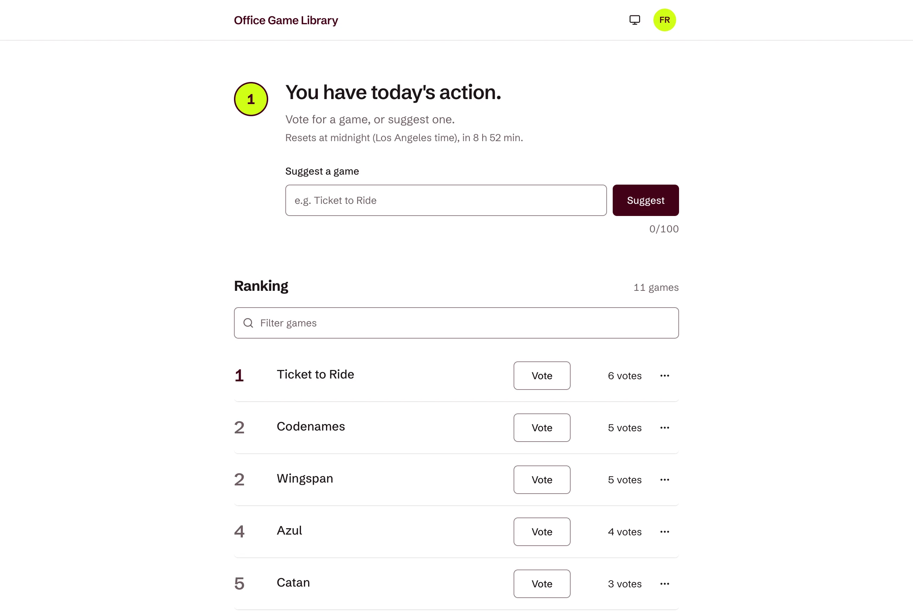
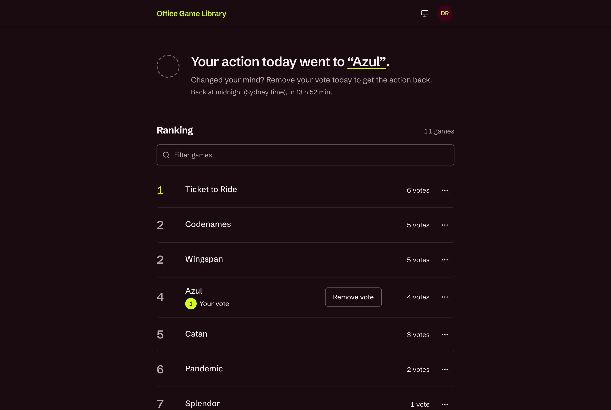

# Office Game Library

Suggest games for the office library and vote on the ones you want most. Each person gets **one action a day**: a
vote or a new suggestion, never both. The ranking reflects what people actually want, not who clicks most.

Laravel 12 (PHP 8.4) with Inertia, React 19 and TypeScript, backed by the Essense Code Challenge API.

<p>
  
  
</p>

## Run with Docker

**Prerequisites:** Docker with Compose (Docker Desktop includes both), and an Essense API key
from <https://codechallenge.essensedesigns.info/api-key>.

```bash
git clone https://github.com/pixelpollux/essense-assessment.git
cd essense-assessment
cp .env.example .env        # then set ESSENSE_API_KEY=your-key in .env
docker-compose up
```

Open <http://localhost:8000> and register an account.

The first run builds the image, which takes a few minutes. After that, `docker-compose up` starts in seconds.

### What happens on start

- The SQLite database is created on a Docker volume (`app-data`), and migrations run automatically.
- An app encryption key (`APP_KEY`) is generated on first start and kept on the same volume, so you stay logged in across restarts.
- The app runs in production mode with debug off, so errors show friendly pages rather than stack traces.

### Useful commands

| Task | Command |
|---|---|
| Check your API key works | `docker-compose exec app php artisan essense:ping` |
| Run in the background | `docker-compose up -d` |
| Follow the app logs | `docker-compose logs -f` |
| Stop | `docker-compose down` |
| Delete every game and vote, keeping accounts | `docker-compose exec app php artisan games:reset --force` |
| Stop and delete local data (accounts, votes, app key) | `docker-compose down -v` |
| Rebuild after pulling new code | `docker-compose up --build` |
| Use a different port | set `APP_PORT=8080` in `.env` |

### Starting over

- **Clear the library but keep accounts:** `docker-compose exec app php artisan games:reset --force`. It deletes every game
  in the Essense API and all local votes and daily actions together, so nothing is left pointing at a deleted game.
  Without `--force` it asks first.
- **A completely empty app:** run `games:reset` first, then `docker-compose down -v`. The volume holds only local data
  (accounts, votes, the app key); the games themselves live in the Essense API, so `down -v` alone leaves them in place.

### Troubleshooting

- **`required variable ESSENSE_API_KEY is missing a value`**: `.env` is missing or `ESSENSE_API_KEY` is empty. Copy `.env.example` to `.env` and set the key.
- **Port 8000 is already in use**: set `APP_PORT` in `.env` to a free port.
- **The app says the game library is unavailable**: run `docker-compose exec app php artisan essense:ping`. It reports
  whether the key is missing, rejected, or the API can't be reached. After changing `.env`, restart with `docker-compose up -d`.

## How the daily rule works

- **One action per day.** Voting for a game and suggesting a new one both use it. Removing a vote or a game never does.
- **"Day" means your day.** Your timezone is detected from your browser when you register, and the day runs from
  midnight to midnight there. **It can't be changed afterwards**: that stops anyone from switching timezones to get a
  second action, at the cost of not following you if you travel.
- **The database enforces it.** A unique index on (user, local date) means two simultaneous requests can't both take
  today's action, whatever the timing.
- **Undoing gives it back.** Remove the vote you cast today and you can act again. If someone removes a game you voted
  for or added today, you get your action back too, and the status line tells you why.
- **One vote per game.** A vote stays until you remove it, so you can't pile votes onto the same game across days.
- **Duplicates are rejected** ignoring case and extra spaces: "Zelda", "zelda" and "  Zelda  " are the same title.

## Architecture

```
Browser: React + Inertia (no client-side data fetching; forms post, the server redirects back)
   │
   ▼
Routes and controllers ── StoreGameRequest (title validation)
   │                     └ RenderUserFacingErrors (every failure becomes a friendly message)
   ▼
GameLibrary: every business rule
   ├── EssenseClient ──► Essense API          owns games and vote totals
   └── SQLite: votes, daily_actions           who voted for what; the daily limit and refunds
```

| What | Where |
|---|---|
| Business rules | `app/Services/Library/GameLibrary.php` |
| API client (all of the API's quirks in one place) | `app/Services/Essense/EssenseClient.php` |
| Routes, controllers, validation | `routes/web.php`, `app/Http/Controllers/`, `app/Http/Requests/StoreGameRequest.php` |
| User-facing error messages | `app/Exceptions/RenderUserFacingErrors.php` |
| The page | `resources/js/pages/games/index.tsx`, `resources/js/components/games/` |
| Artisan commands | `essense:ping`, `games:reset` in `app/Console/Commands/` |
| Design system | `DESIGN.md` (tokens in `resources/css/app.css`) |

## Decisions and trade-offs

The full reasoning is in [`CLAUDE.md`](CLAUDE.md) ("Decisions") and [`docs/api-notes.md`](docs/api-notes.md), which
records what testing the API by hand revealed.

- **The API owns games and totals; the database owns who did what.** The API only stores a count per game, so knowing
  whether *you* voted for something has to live locally.
- **Local change first, then the API, undoing on failure.** The database decides any race; the API can't. Removing a
  game is the exception: it calls the API first, because removing twice is harmless.
- **Ambiguous timeouts are undone and flagged.** If a vote times out, the API may have counted it anyway. The app
  undoes the local change and tells the user to check the count, accepting a possible total that's one too high over
  local records that disagree with the API. Changes are never retried, so a vote can't be counted twice.
- **Game IDs restart after `/cache/flush`.** Local rows store the game's name next to its ID and only count while both
  match, so a vote can't silently attach to a new game that reused an old ID.
- **The API stores titles HTML-escaped**, and escapes already-escaped text again, so the client decodes exactly once.
- **`removeVote` reports success even at 0 votes**, so the app only calls it for a vote it has on record.

## Testing

```bash
php artisan test
```

122 tests, aimed at the rules rather than coverage numbers:

- **`GameLibraryTest`**: the daily rule in Sydney, Los Angeles and UTC, at 23:59:59 and 00:00:00 local time; refunds;
  duplicates; leftovers after a flush; undoing local changes when the API fails. It runs on real SQLite tables
  against an in-memory fake of the API.
- **`GameRoutesTest`**: routes, title validation, and that each failure reaches the user as the right message.
- **`EssenseClientTest`**: one test per API quirk in `docs/api-notes.md`, against faked HTTP. No test can reach the
  real API (`Http::preventStrayRequests()`), and `phpunit.xml` sets a fake key.
- **Command tests** for `essense:ping` and `games:reset`.

CI runs the tests and a lint job (Pint, Prettier, ESLint and TypeScript, all in check mode) on pull requests.

## Local development without Docker

Requires PHP 8.4, Composer and Node 22.

```bash
composer install
npm install
cp .env.example .env              # set ESSENSE_API_KEY
php artisan key:generate
touch database/database.sqlite
php artisan migrate
composer dev                      # app server, Vite and logs together
```

## Known limitations

- **The timezone can't be edited** after registration (see the daily rule above).
- **A timeout can leave an API total one too high**: the trade-off described above.
- **The race between two people adding the same title at the same moment** is guarded by a cache lock, but a true
  two-process race isn't covered by tests; only "an add waits for, then gives up on, a held lock" is.
- **Games added or removed outside the app** (for example from the API's docs page) don't trigger refunds.

## How this was built with AI

Built with Claude Code. The full conversation, from the first message to the last, is in
[`docs/ai-transcript.md`](docs/ai-transcript.md).

- [`CLAUDE.md`](CLAUDE.md) holds the working agreements: plan before changing anything, small diffs, explain Laravel
  concepts as they come up, no new packages without asking, and standard Laravel conventions.
- The API's behaviour was tested by hand before any client code was written ([`docs/api-notes.md`](docs/api-notes.md)).
- Business-rule tests were written and reviewed before the service that makes them pass.
- The page was designed with the `/impeccable` and `/frontend-design` skills, including an independent review pass.
  The design system is recorded in [`DESIGN.md`](DESIGN.md).
